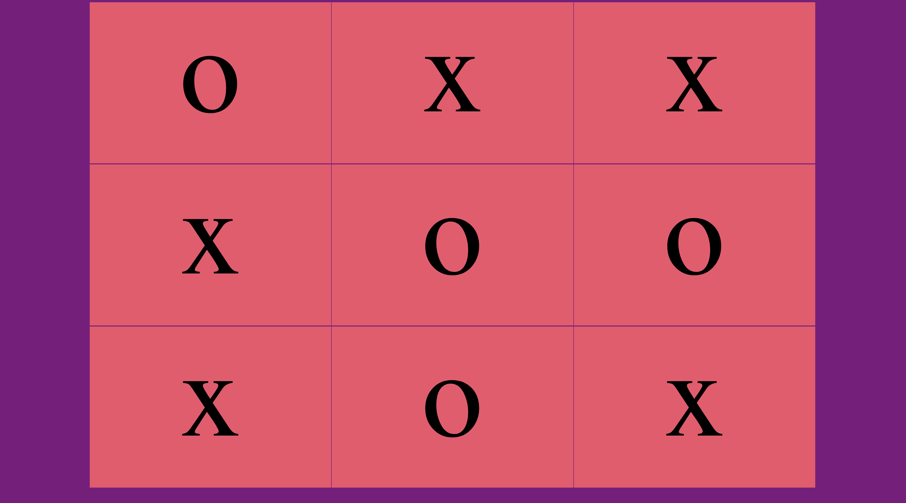

# Tic-Tac-Toe ❌⭕

A two-player tic-tac-toe game you play in the browser by taking turns clicking the squares.

## Description

This is a project I built to practice JavaScript logic and working with the page. Two players share the screen. Player X goes first, then O, and each click puts that player's mark in a square. After every move the game checks all the ways to win (3 rows, 3 columns, and 2 diagonals) and pops up a message when someone wins or the board is full. It uses plain HTML, CSS, and JavaScript, so there is no server to run.

## Screenshot

## Features

- Two players take turns, X first and then O
- Click an empty square to place your mark
- A square that's already taken can't be changed
- Checks all 8 winning lines after every move
- Pops up a message when someone wins
- Pops up a message when the board is full and nobody won
- A `restartGame()` function that clears the board (not connected to a button yet)
- Purple background with pink squares

## Tech Used

- HTML
- CSS
- JavaScript

## How to Use

1. Download or clone the project.
2. Open `index.html` in your browser (or use the Live Server extension in VS Code).
3. Player X clicks a square to go first.
4. Player O clicks a square, and keep taking turns.
5. To play again, refresh the page.

## How It Works

1. `main.js` keeps track of whose turn it is in a variable called `currentPlayer`, which starts as `'x'`.
2. Each square listens for a click. If the square already has a mark, nothing happens.
3. Otherwise it puts the current player's mark in the square.
4. It then checks a list of all 8 winning lines (like squares 0, 1, 2 or 0, 4, 8). If one player owns all three squares in any line, they win.
5. If nobody won and every square is filled, it says it's a draw.
6. If the game goes on, it switches to the other player.

## What I Learned

- How to listen for clicks on many elements at once with `forEach` and `addEventListener`
- How to keep track of the current player with a variable
- How to use `.every()` to check if the board is full
- How to use a ternary (`? :`) to switch turns
- How to lay out a grid with floats and a clearfix in CSS

VIEW APP HERE: https://tic-tac-toe-9204.onrender.com/

## Author

Maya Rose 🌹
